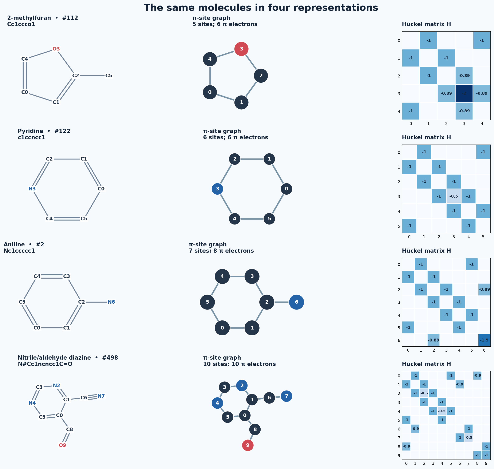
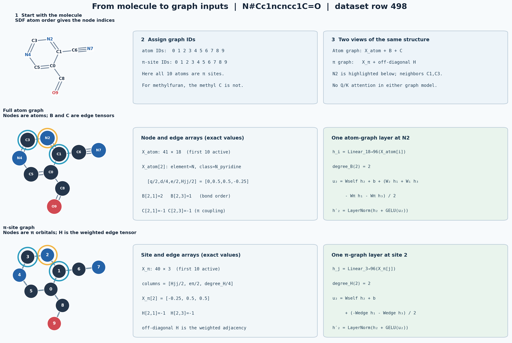

# Visualizing chemical representations

These figures use **actual rows from the 10,000-molecule heteroatom Hückel dataset** and the exact prepared inputs for the HOMO–LUMO-gap models in [`representation_gap_probe`](../four_family_grokking/representation_gap_probe/). SDF 2D coordinates set the drawings. Atom numbers and π-site numbers follow the stored array order; the two orders need not coincide.

The implementation source and attribution status for these encoders is recorded in [`PROVENANCE.md`](../four_family_grokking/representation_gap_probe/PROVENANCE.md). The SMILES IDs shown here come from a vocabulary generated within this repo, not a loaded ChemBERTa tokenizer.

The [pericyclic Hückel–Möbius transition-state atlas](pericyclic_ts_atlas/README.md) shows orbital circuits for Diels–Alder, ene, Claisen, Cope, cycloadditions, and electrocyclic closures.

The [orbital-lobe reaction schemes](pericyclic_ts_atlas/orbital_schemes/README.md) show **reactant orbitals → proposed transition state → product**, with paired allowed and forbidden approaches: [overview](pericyclic_ts_atlas/orbital_schemes/figures/orbital_selection_overview.png) · [eight-page PDF](pericyclic_ts_atlas/orbital_schemes/pericyclic_orbital_schemes.pdf).



## Numbered structure → raw training numbers

These are the direct numeric maps for dataset row 498 (`N#Cc1ncncc1C=O`). The numbered structure is beside the **actual active tensor entries**, rounded for figure legibility. Gold connects atom 2 to row 2 of the feature array and to its bond/coupling cells.

- [Atom graph: 18-number atom rows plus bond-order and π-coupling arrays](figures/numbered_to_atom_graph_tensors.png) ([editable SVG](figures/numbered_to_atom_graph_tensors.svg))
- [π graph and Hückel rows: three-number site rows, H, and 41-number row tokens](figures/numbered_to_pi_and_matrix_tensors.png) ([editable SVG](figures/numbered_to_pi_and_matrix_tensors.svg))

Each plot shows the active 10-atom/site block so individual values remain readable. The exact **full padded tensors** are in [`selected_inputs.npz`](selected_inputs.npz), and every input is also exported as a plain numeric CSV in [`raw_arrays/`](raw_arrays/README.md). The CSVs include the zero padding and masks.

## Graph story for a chemistry audience

Starting from the numbered structure, these three slides explain the graph without assuming machine-learning vocabulary:

1. [Numbered structure → atom and connection lists](figures/graph_story_1_numbered_to_lists.png)
2. [One atom and its bonds → numerical inputs](figures/graph_story_2_lists_to_numbers.png)
3. [Neighbor exchange → molecule prediction](figures/graph_story_3_neighbors_to_gap.png)

The slides are also bundled as a [presentation PDF](figures/graph_story_for_non_ml_audience.pdf). Matching SVG files are in `figures/` for editing. The 2D coordinates in the structure are for visualization; the graph model receives atom and connection arrays, not coordinates.

## Technical graph walkthrough

The [graph encoding walkthrough](figures/graph_encoding_walkthrough.png) uses the same `N#Cc1ncncc1C=O` molecule as the SMILES example. It follows the molecule into two different graph encodings, highlights N2 and its neighbors C1/C3, gives the exact stored node and edge values, and shows one message update for each graph model. An [editable SVG](figures/graph_encoding_walkthrough.svg) is also available.



## Figures

| Molecule | SMILES | Dataset row | Views | Numeric encodings |
|---|---|---:|---|---|
| 2-methylfuran | `Cc1ccco1` | 112 | [views](figures/methylfuran_views.png) | [encodings](figures/methylfuran_encodings.png) |
| Pyridine | `c1ccncc1` | 122 | [views](figures/pyridine_views.png) | [encodings](figures/pyridine_encodings.png) |
| Aniline | `Nc1ccccc1` | 2 | [views](figures/aniline_views.png) | [encodings](figures/aniline_encodings.png) |
| Nitrile/aldehyde diazine | `N#Cc1ncncc1C=O` | 498 | [views](figures/diazine_nitrile_aldehyde_views.png) | [encodings](figures/diazine_nitrile_aldehyde_encodings.png) |

The [encoder-path diagram](figures/encoder_paths.png) connects each numeric input to the model that receives it. The `views` pages show the SDF bond drawing, full atom graph, π-site weighted graph, active Hückel matrix, full bond-order matrix, and SMILES token IDs. The `encodings` pages show row tokens, π-graph node features, 18-channel atom features, π-coupling edges, padding, masks, and global inputs.

## What each model actually receives

| Model | Deterministic input | Learned path |
|---|---|---|
| `matrix_rows` | `H` padded to 40×40, site π electrons, active-site mask, `aux` | Each of 40 rows becomes `[H[j,0:40], eπ,j/2]` (41 values), then a 128-dimensional linear map, learned site position, CLS token, one attention layer, and an MLP. |
| `pi_graph` | Same `H`, site π electrons, active-site mask, `aux` | Site features `[Hjj/2, eπ,j/2, degree(H off-diagonal)/4]`; off-diagonal `Hjk` weights the messages in six graph layers. |
| `molecular_graph` | 41-node padded atom graph: 18-channel node features, bond-order adjacency, π-coupling adjacency, atom mask, `aux` | Four graph layers use bond orders and mapped `Hjk` couplings; mean/max pooling and an MLP. |
| `smiles` | `[CLS]` plus lexical canonical-SMILES token IDs, padded to length 68, `aux` | 96-dimensional token embedding, learned positions, two transformer layers, CLS readout, and an MLP. |

The atom feature vector has six element one-hot channels (`C,N,O,S,F,Cl`), eight π-site-class one-hot channels, then `[formal_charge/2, atom_degree/4, site_π_electrons/2, Hjj/2]`. For an atom outside the π system, its π-class channels and final two values are zero. `aux = [n_π_electrons/40, n_π_sites/40]` is supplied to each of the four enriched models. The learned embedding values depend on model weights; the figures show the exact **deterministic inputs** before those learned transformations.

The active blocks are shown in the figures for legibility. [`selected_inputs.npz`](selected_inputs.npz) contains the **full padded arrays copied from `features.npz`** for the four selected rows, plus the derived 41-value matrix row tokens, three-channel π-graph node features, atom mask, and site-to-atom mapping. [`encodings.json`](encodings.json) contains readable active blocks, site-to-atom mapping, token IDs, node features, and edge matrices. Hückel couplings and gaps use the dataset's `|β|` energy scale.

These views also explain a likely source of the row model's site-numbering sensitivity: `H[j,k]` is placed in fixed column `k`, while the π-graph model aggregates neighbors through the graph edges. Relabeling the same sites permutes row coordinates but leaves the chemical system and its eigenvalues unchanged.

## Regenerate

From the OPSandbox root:

```bash
python VisualizingChemReps/visualize.py
python VisualizingChemReps/non_ml_graph_story.py
python VisualizingChemReps/raw_tensor_diagrams.py
```

Requires NumPy and Matplotlib. The script reads `heteroatom_huckel_dataset/{dataset.npz,molecules.sdf}` and `four_family_grokking/representation_gap_probe/{features.npz,vocab.json}`. It checks the matrix, atom-index mapping, bond orders, token IDs, node-feature scalars, and padding before writing figures.
