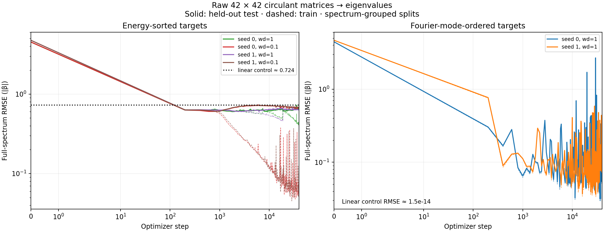

# Circulant spectrum animations

Open [the interactive gallery](index.html) or any GIF below. All animations use actual saved checkpoints.

| Run | Train RMSE | Test RMSE | Linear test RMSE | Animations |
|---|---:|---:|---:|---|
| mode_seed0 | 0.05076 | 0.05166 | 1.45e-14 | [Embeddings](mode_seed0/representations.gif) · [Frequencies](mode_seed0/frequencies.gif) · [Ablations](mode_seed0/causal_ablations.gif) |
| mode_seed1 | 0.11971 | 0.11989 | 9.67e-15 | [Embeddings](mode_seed1/representations.gif) · [Frequencies](mode_seed1/frequencies.gif) · [Ablations](mode_seed1/causal_ablations.gif) |
| sorted_seed0 | 0.41361 | 0.65547 | 0.724 | [Embeddings](sorted_seed0/representations.gif) · [Frequencies](sorted_seed0/frequencies.gif) · [Ablations](sorted_seed0/causal_ablations.gif) |
| sorted_seed0_wd0p1 | 0.10831 | 0.68133 | 0.724 | [Embeddings](sorted_seed0_wd0p1/representations.gif) · [Frequencies](sorted_seed0_wd0p1/frequencies.gif) · [Ablations](sorted_seed0_wd0p1/causal_ablations.gif) |
| sorted_seed1 | 0.63442 | 0.64047 | 0.728 | [Embeddings](sorted_seed1/representations.gif) · [Frequencies](sorted_seed1/frequencies.gif) · [Ablations](sorted_seed1/causal_ablations.gif) |
| sorted_seed1_wd0p1 | 0.05661 | 0.68079 | 0.728 | [Embeddings](sorted_seed1_wd0p1/representations.gif) · [Frequencies](sorted_seed1_wd0p1/frequencies.gif) · [Ablations](sorted_seed1_wd0p1/causal_ablations.gif) |

See [experiment methods](../README.md) for the split, controls, and interpretation limits.
