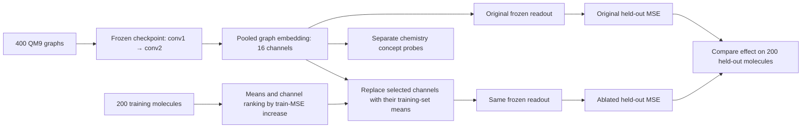

# Omnigrok QM9 channel ablations (N=400)

These measurements replay the archived checkpoints behind
[predictions_total400.gif](../../predictions_total400.gif): 200 training and
200 held-out QM9 molecules, predicting scalar isotropic polarizability. The
network has a 16-channel graph representation after global sum pooling, a
32-channel ReLU readout layer, and one scalar output. It has no token embedding
table or classification logits.

## Method

At each checkpoint, a channel is replaced with its mean over **training**
molecules and the frozen downstream layers produce a new prediction. We rank
channels by their *individual* increase in training MSE, then measure held-out
MSE when removing or retaining the highest-ranked channels. Twenty random
groups of matching size provide a reference. No held-out targets select
channels. The [full results](summary.json) also contain the random trials,
active-channel fractions, and the effect of each individual channel.

The linear probes refit only a ridge readout on the training molecules. Their
penalties use five-fold training-only cross-validation. This asks whether the
saved representation contains an accessible target signal, without changing
the graph convolutions.

## Results

| Model and step | Original test MSE | Active pooled channels / 16 | Retain top 4 pooled: test MSE | Retain top 8 pooled: test MSE |
| --- | ---: | ---: | ---: | ---: |
| α=3, 10,000 | 83.028 | 13 | 4,887.690 | 106.484 |
| α=3, 20,000 | 5.532 | 10 | 6.983 | 5.512 |
| α=3, 40,000 | 0.786 | 5 | 0.789 | 0.786 |
| α=3, 87,500 | 1.088 | 4 | 1.090 | 1.088 |
| α=1, 40,000 | 0.792 | 8 | 1.197 | 0.792 |

At step 40,000, the α=3 model keeps essentially all of its held-out accuracy
with the four most training-important pooled channels. The α=1 control needs
more than four for the same accuracy, although its eight active pooled
channels are also sparse. Removing the single most important pooled channel
raises α=3 held-out MSE about 90-fold; removing a bottom-ranked channel has
little effect. The [focused comparison](pooled_channel_compactness_step40000.png)
shows the four-channel result; [removal](channel_ablation_step40000.png) and
[retention](channel_sufficiency_step40000.png) figures include the readout
layer and random groups.

| α=3 step | Trained model test MSE | Pooled-16 linear probe test MSE | Readout-32 linear probe test MSE |
| ---: | ---: | ---: | ---: |
| 10,000 | 83.028 | 12.371 | 28.765 |
| 20,000 | 5.532 | 2.792 | 2.760 |
| 40,000 | 0.786 | 0.904 | 0.935 |
| 87,500 | 1.088 | 1.078 | 0.959 |

At 10,000 steps, a simple readout of the frozen pooled features predicts much
better than the model's existing head. This is evidence that useful target
information is present before the trained head uses it effectively in this
run. The [probe figure](readout_probes.png) shows the full trajectory. By
40,000 steps, the trained head gives the best result among these probes. The
α=3 model's test MSE later rises to 1.088; the α=1 control reaches 0.792 at
40,000 steps and 0.692 at the final checkpoint. The train-set mean predictor
has test MSE 94.85.

These are frozen-checkpoint interventions on one archived run and one split.
Mean replacement can move an example off the model's usual activation
manifold, especially when removing an important channel, so large error
increases do not by themselves identify a unique mechanism. Channel rankings
also depend on this basis and can change under retraining.

## Process diagram

The ablation measures whether a channel's variation matters to the output.
The [chemistry probe pilot](../../chemistry_probes/total400/README.md) tests
whether chemical concepts can be read from the same frozen embedding.

Regenerate from the project root with `.venv/bin/python ablate_qm9.py`.
