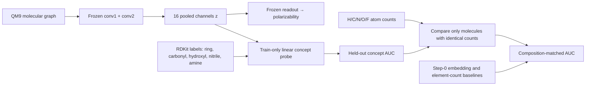
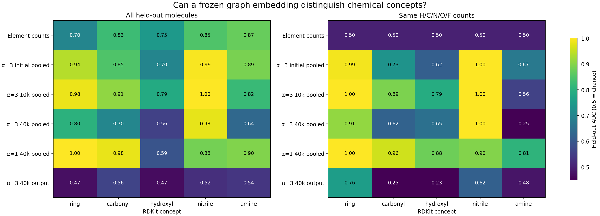

# What chemistry is visible in the Omnigrok graph embedding?

The [channel ablation](../../ablations/total400/README.md) tells us which
hidden channels affect polarizability prediction. It does not assign chemical
meaning to those channels. This pilot asks a different question: can a small
linear probe read specific chemical concepts from the **frozen 16-channel
pooled graph representation**?

## Two complementary measurements

The model sees atom and bond features, but no 3D coordinates. We label each
of the same first 400 QM9 molecules with RDKit SMARTS patterns. For each
concept, a ridge score is fitted on the archived 200 training molecules;
five-fold training-only cross-validation selects its penalty. We report AUC
on the 200 held-out molecules. The matched AUC compares positive and negative
molecules **with exactly the same H/C/N/O/F counts**. An element-count-only
score must tie on those pairs, giving AUC 0.5. These pairs share molecules,
so pair counts are descriptive and are not independent samples.

## Pilot results

| Concept | Matched held-out pairs | α=3 at initialization | α=3 at 40k | α=1 at 40k |
| --- | ---: | ---: | ---: | ---: |
| Ring | 111 | 0.99 | 0.91 | 1.00 |
| Carbonyl | 101 | 0.73 | 0.62 | 0.96 |
| Hydroxyl | 115 | 0.62 | 0.65 | 0.88 |
| Nitrile | 68 | 1.00 | 1.00 | 0.90 |
| Amine | 52 | 0.67 | 0.25 | 0.81 |

The α=3 representation still carries some structural information at 40k,
especially ring and nitrile distinctions, but its concept recoverability is
uneven. Several concepts are already recoverable at **step zero**, so a good
probe score alone does not demonstrate that training learned the concept.
α=1 and α=3 have nearly identical polarizability test MSE at 40k, yet these
probes read more of the tested chemistry from α=1. These results are a
descriptive first pass, not a causal map of individual neurons.

For the continuous target, train-only ridge fits give held-out polarizability
MSE of **21.29** from total atom count, **1.508** from H/C/N/O/F counts, and
**1.015** from those counts plus the five concept labels. The two trained
networks reach about **0.79** at 40k. Thus their accuracy exceeds these simple
baselines on this split, while the element-count baseline already explains a
large share of the target variation. This does not establish which more
detailed structural or physical relation the networks use.

The [full JSON](summary.json) includes ordinary AUC, composition-matched AUC,
class prevalence, 20k and final checkpoints, and pooled-plus-element-count
controls. It also includes a mean AUC over composition groups, so a few
formulas cannot silently dominate the pair-weighted AUC. The amine class is
relatively small (15 positive training and 22
positive test molecules), so its AUC is particularly fragile. Two stored QM9
SMILES needed RDKit's non-strict parsing fallback; their original graph
features were used without alteration.

## Next tests for a stronger chemical interpretation

1. Select **matched molecular pairs** that differ in one substructure while
   keeping element counts and as much of the scaffold as possible. Compare
   their pooled vectors, atom activations, model predictions, and true
   polarizabilities. The matched AUC above is the first quantitative check.
2. Map **atom or chemically segmented fragment contributions** to the model's
   output, and check whether masking a fragment changes the prediction in the
   expected direction. Masking must preserve a meaningful molecular graph;
   arbitrary atom deletion can create misleading inputs.
3. Probe **other QM9 labels** such as dipole moment or frontier orbital
   energies, with element-count and step-zero controls. This would test what
   survives the polarizability bottleneck beyond the training target.

[Akhondzadeh et al., *Probing Graph Representations*](https://proceedings.mlr.press/v206/akhondzadeh23a.html)
provide the closest published framework: atom counts, functional groups,
other properties, random-initialization controls, and paired probing. The
[QM9 message-passing study by Gilmer et al.](https://proceedings.mlr.press/v70/gilmer17a.html)
distinguishes graph-only input from models that also see molecular geometry.
This reproduction uses graph-only input, so its probes cannot establish an
internal model of 3D electronic response. The
[substructure-masking study by Wu et al.](https://pmc.ncbi.nlm.nih.gov/articles/PMC10160109/)
motivates explanations at chemically meaningful fragment scale. The
[NeurIPS attribution benchmark by Sanchez-Lengeling et al.](https://proceedings.neurips.cc/paper_files/paper/2020/hash/417fbbf2e9d5a28a855a11894b2e795a-Abstract.html)
motivates quantitative checks rather than relying on plausible-looking atom
highlights.

Regenerate from the project root with `.venv/bin/python probe_chemistry_qm9.py`.
